# Élan Atelier — Real-Time Salon Queue Management System 
[](https://salon-queue-management-mauve.vercel.app/)
[](https://salon-queue-management-mauve.vercel.app/)
[](https://salon-queue-management-mauve.vercel.app/)
[](https://salon-queue-management-mauve.vercel.app/)

## Detailed Documentation on Deepwiki.com [Ask DeepWiki](https://deepwiki.com/aarshpatel1/Salon-Queue-Management)

> 🌐 **Live Deployed Application**: [https://salon-queue-management-mauve.vercel.app/](https://salon-queue-management-mauve.vercel.app/)  
> ⚡ **Cloud Backend API**: Hosted on Render with automated self-ping keep-alive service.  
> 📜 **Engineering Prompts Record**: See [prompts.md](prompts.md) for the complete prompt engineering history.  
> 📖 **Comprehensive User Guide**: See [USER_GUIDE.md](USER_GUIDE.md) for detailed operational walkthroughs.

---

A production-grade, full-stack reactive salon queue management platform designed for luxury grooming studios. Built with **React 19**, **Vite**, **Tailwind CSS v4**, **Plus Jakarta Sans**, **Node.js (ES Modules)**, **Express**, **MongoDB (Mongoose)**, **Socket.io**, **Passport.js JWT**, and **Cloudinary CDN**.

---

## Table of Contents
1. [Live Deployment & Quick Links](#live-deployment--quick-links)
2. [Project Screenshots & Visual Showcase](#project-screenshots--visual-showcase)
3. [Project Overview](#project-overview)
4. [Key Features](#key-features)
5. [Recent Updates & Advanced Capabilities](#recent-updates--advanced-capabilities)
   - [Automated Render.com Cold Spin-Down Mitigation (Keep-Alive)](#automated-rendercom-cold-spin-down-mitigation-keep-alive)
   - [Suite of Luxury Shimmer Skeleton Loaders](#suite-of-luxury-shimmer-skeleton-loaders)
   - [Full Stylist (Barber) Roster CRUD Management](#full-stylist-barber-roster-crud-management)
   - [In-Flight Customer Queue Ticket Editing](#in-flight-customer-queue-ticket-editing)
   - [Live Drag-and-Drop Queue Priority Reordering](#live-drag-and-drop-queue-priority-reordering)
   - [Smart Avatar & Dual-Initials Generator](#smart-avatar--dual-initials-generator)
   - [Liquid Spring Morphing Dynamic Island](#liquid-spring-morphing-dynamic-island)
   - [Plus Jakarta Sans Luxury Typography](#plus-jakarta-sans-luxury-typography)
6. [Architecture & Technology Stack](#architecture--technology-stack)
7. [End-to-End Application Flows](#end-to-end-application-flows)
   - [Flow 1: Customer Self-Check-in & Live Queue Tracking](#flow-1-customer-self-check-in--live-queue-tracking)
   - [Flow 2: Reception Desk Console (Tablet)](#flow-2-reception-desk-console-tablet)
   - [Flow 3: Stylist Chair Station (Mirror Tablet)](#flow-3-stylist-chair-station-mirror-tablet)
   - [Flow 4: Ambient Lounge TV Display](#flow-4-ambient-lounge-tv-display)
   - [Flow 5: Studio Owner / Admin Settings](#flow-5-studio-owner--admin-settings)
8. [Queue Engine & Algorithmic Design](#queue-engine--algorithmic-design)
   - [State Transition Model](#state-transition-model)
   - [Wait Time Estimation Formula](#wait-time-estimation-formula)
   - [First-Come-First-Served (FCFS) Stylist Matching](#first-come-first-served-fcfs-stylist-matching)
9. [UI & UX Design System](#ui--ux-design-system)
   - [Theme Color Palette](#theme-color-palette)
   - [Custom Scrollbars](#custom-scrollbars)
   - [Dynamic Bottom Status Bar & Upward Modal Morphing](#dynamic-bottom-status-bar--upward-modal-morphing)
   - [Adaptive Timer Formatting (`HH:MM:SS` / `MM:SS`)](#adaptive-timer-formatting-hhmmss--mmss)
10. [Security & Authentication](#security--authentication)
11. [Complete Directory Structure](#complete-directory-structure)
12. [Getting Started & Configuration](#getting-started--configuration)
    - [Prerequisites](#prerequisites)
    - [Environment Setup](#environment-setup)
    - [Database Seeding & JSON Import](#database-seeding--json-import)
    - [Running Locally](#running-locally)
13. [Ownership & Intellectual Property](#ownership--intellectual-property)

---

## Live Deployment & Quick Links: [https://salon-queue-management-mauve.vercel.app/](https://salon-queue-management-mauve.vercel.app/)


---

## Project Screenshots & Visual Showcase

### 1. Customer Landing & Lounge Live Queue View
*Displays salon open/closed status, current estimated wait, active stylist chair cards, and the live queue ticker.*

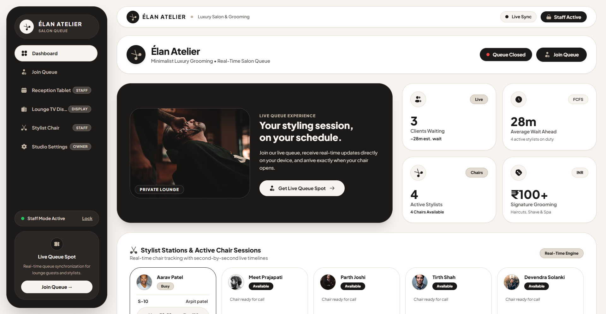

---

### 2. 2-Column Customer Self Check-in
*Features 10-digit mobile number validation, multi-service selection with dynamic price calculation, preferred stylist selector, and sticky summary card.*

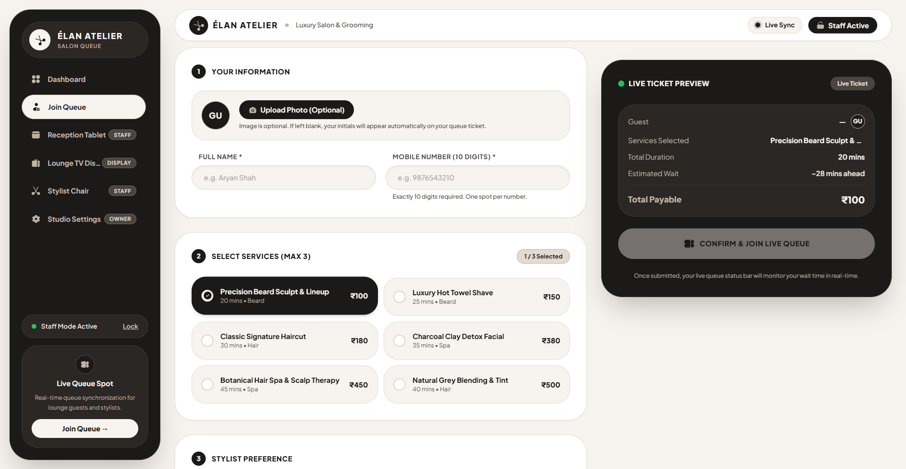

---

### 3. Customer Ticket Status & Audio Calling Alerts
*Personalized status page showing real-time queue countdown, position indicator (`#2 in line`), and station call alerts.*

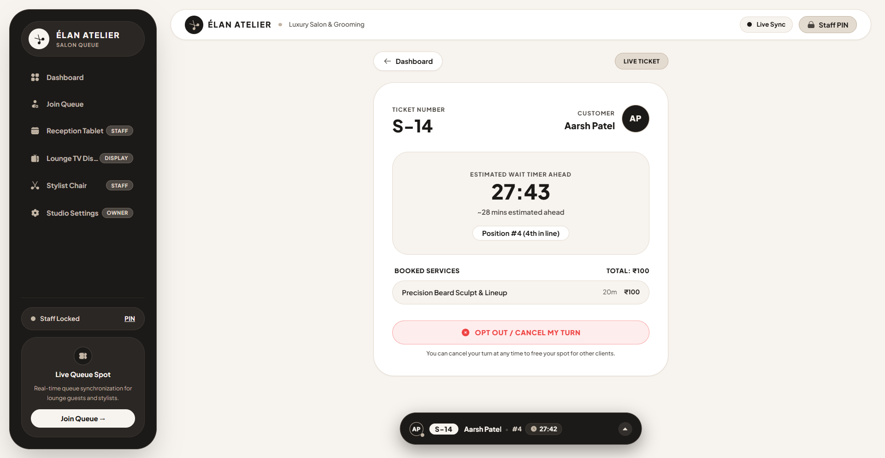

---

### 4. Liquid Spring Morphing Dynamic Island
*Persistent bottom floating pill that morphs upward into a full modal ticket drawer on click.*

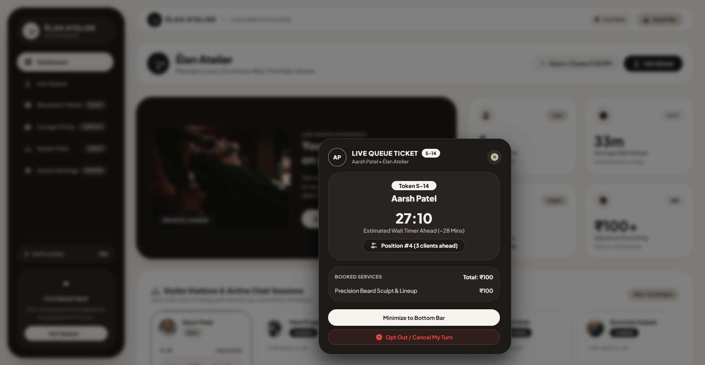

---

### 5. Front Desk Reception Console & Walk-In Modal
*Real-time command center showing all stylist chair stations, walk-in registration, and active queue management.*

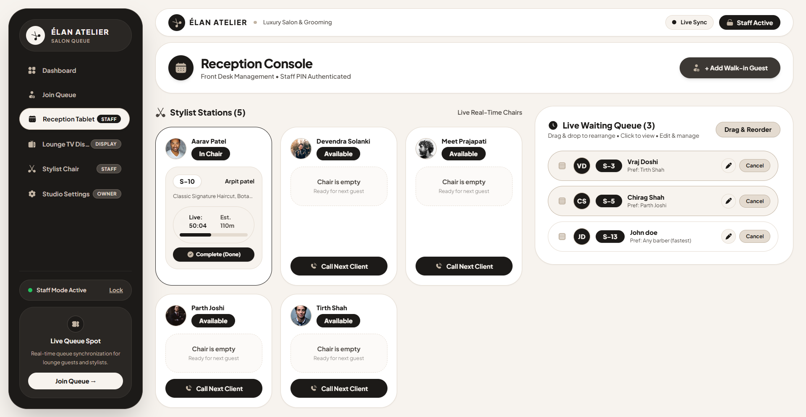

---

### 6. Ambient 100dvh Lounge TV Display
*High-contrast dark mode display for lounge screens showing active chair allocations, waiting ticker, and audio chime alerts.*

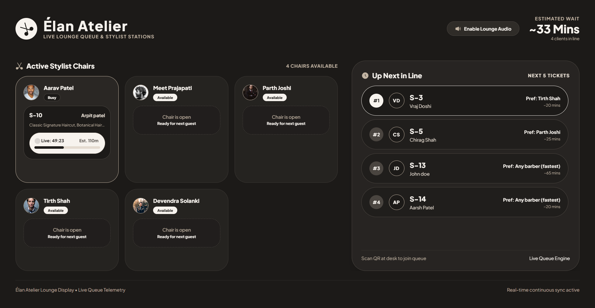

---

### 7. Staff Self Management Page
*Barbers can see the current working status, upcoming customer and taking break controls*

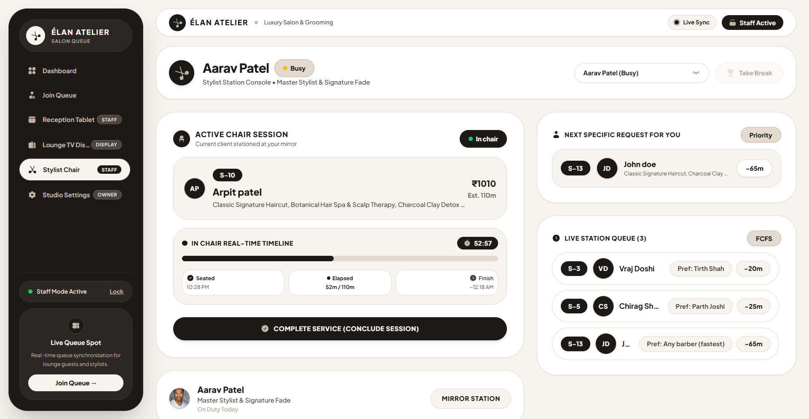

---

### 8. Studio Admin Dashboard & Barber Roster CRUD
*Live business KPIs, Stylist Roster CRUD modal (`BarberModal.jsx`), service catalog manager, and salon configuration.*

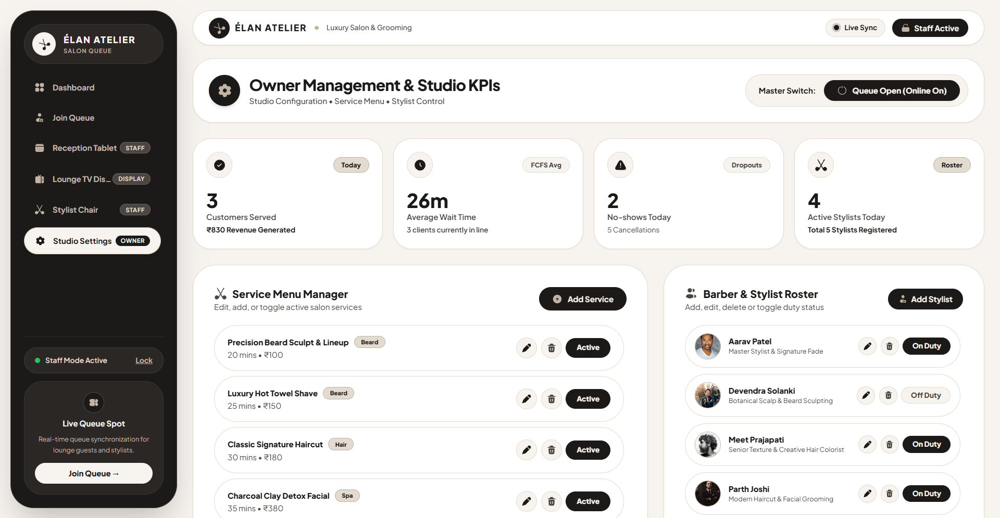

---

### 9. Luxury Shimmer Skeleton Loaders Suite
*Tailored skeleton shimmer loading states eliminating layout shift across all major application views.*

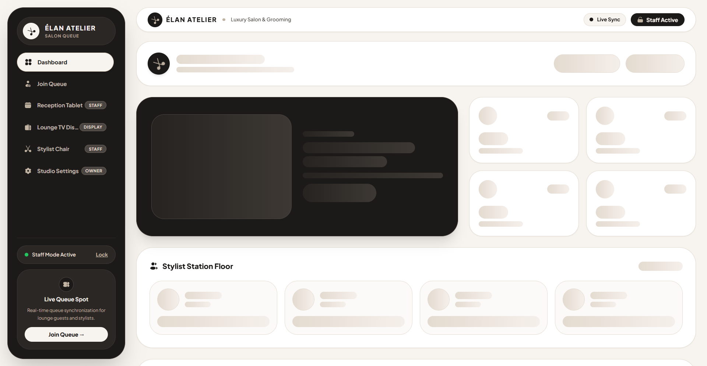

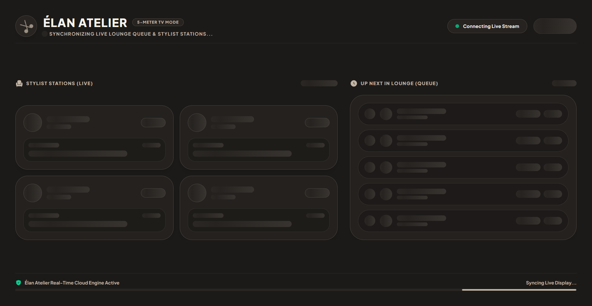

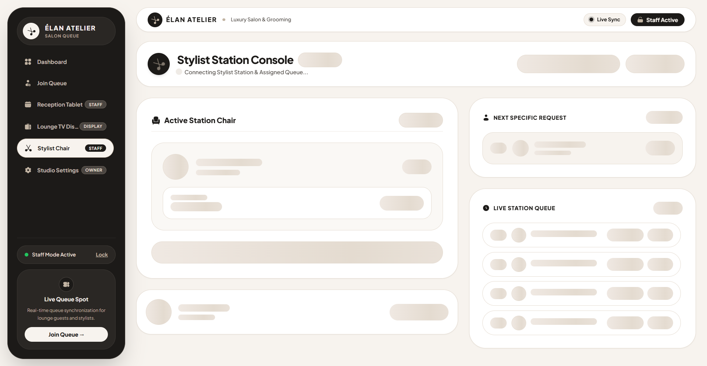

---

## Project Overview

Élan Atelier solves the chaotic physical wait line problem common to premium salons and barber studios. Instead of customers crowding into a waiting lounge or missing appointments, Élan Atelier provides:
- **Instant mobile self check-in** with real-time wait estimation.
- **A persistent floating status bar (Dynamic Island)** that follows the customer on their device with live countdown timers.
- **Auditory and visual alerts** (chimes, vibrations, confetti) when a station opens.
- **Dedicated staff consoles** for receptionists and stylists to call, seat, and conclude sessions.
- **An ambient lounge TV screen** displaying real-time chair allocations and waiting line numbers.
- **Centralized admin controls** with Cloudinary image upload, operating hours, and live KPIs.
- **Automated Render.com keep-alive engine** ensuring zero sleep delays on cloud hosting.

---

## Key Features

- **Sub-Second Real-Time Sync**: Every state transition (joining, calling, seating, completing) broadcasts across all connected screens via Socket.io in $< 100\text{ms}$.
- **Smart FCFS Queue Engine**: Fair, automated assignment that respects individual stylist preferences while optimizing throughput.
- **Desktop Side-by-Side Responsive Layouts**: Ergonomic split-screen views for both customer registration (`/join`) and stylist stations (`/barber/:name`).
- **Resilient Cloudinary Asset Storage**: Automatic upload of studio banners to Cloudinary CDN with graceful offline base64 fallback.
- **Non-Intrusive PIN Module**: Staff protected areas require a 4-digit PIN. Pressing `Escape` or clicking cancel immediately closes the modal and redirects back to the previous page.
- **Adaptive Timers**: Live session and wait timers automatically display in `HH:MM:SS` if 1 hour or more, and `MM:SS` otherwise.
- **Custom Theme Scrollbars**: Seamless obsidian and camel-gold scrollbar styling across Chrome, Safari, Edge, and Firefox.

---

## Recent Updates & Advanced Capabilities

### Automated Render.com Cold Spin-Down Mitigation (Keep-Alive)
- **Problem**: Free-tier cloud instances on Render.com enter sleep mode after 15 minutes of inactivity, resulting in a 50+ second latency on subsequent requests.
- **Engineered Solution**: Implemented an automated internal keep-alive service in `server/utils/keepAlive.js`:
  - Automatically detects the deployed instance URL (`RENDER_EXTERNAL_URL` or `SERVER_URL`).
  - Periodically self-pings `/api/keep-alive/ping` every 30 to 60 seconds.
  - Exposes `/api/keep-alive` to report system uptime, ping frequency, and health telemetry.
  - Can be toggled on/off via `ENABLE_KEEP_ALIVE=true`.

### Suite of Luxury Shimmer Skeleton Loaders
Replaced generic spinners with geometric shimmer skeletons matching the exact layout of each view:
- **`ReceptionLoader.jsx`**: Mimics the stylist station card grid and waiting queue table.
- **`StylistLoader.jsx`**: Mirrors the desktop side-by-side chair console and queue telemetry, including a dedicated loading transition when switching active barbers.
- **`WaitingTVLoader.jsx`**: Dark-theme 100dvh skeleton layout for large lounge displays.
- **`HomeLoader.jsx`**: Renders skeletons for the studio hero banner, active chair capsules, and live ticker.
- **`AdminLoader.jsx`**: Skeletons for analytics metric cards, service tables, and stylist cards.
- **`DesktopLoader.jsx`**: Smooth 850ms intro splash featuring an animated brand scissors badge and loading bar.

### Full Stylist (Barber) Roster CRUD Management
- **`BarberModal.jsx`**: Complete administrator modal to create, edit, and delete salon stylists.
- Configure stylist name, specialty tags, on-duty status, and optional headshot photo.
- Real-time updates propagate instantaneously to the customer booking dropdown and receptionist consoles.

### In-Flight Customer Queue Ticket Editing
- **`EditCustomerModal.jsx`**: Front desk staff can edit waiting tickets directly without cancelling:
  - Update customer name and 10-digit mobile number.
  - Add or remove grooming services (recalculates estimated duration and pricing).
  - Re-assign preferred barber or switch to "Any Stylist".
  - Manually change status or cancel turn.

### Live Drag-and-Drop Queue Priority Reordering
- Receptionists can dynamically adjust ticket priority:
  - Drag customer cards using the grip handle (`:::`) to move guests up or down in line.
  - MongoDB updates sequence numbers in bulk, triggering a WebSocket broadcast to update all client timers and TV tickers instantly.

### Smart Avatar & Dual-Initials Generator
- **`Avatar.jsx`**: Universal avatar component for stylists and guests.
- If an image is missing or fails to load, the component dynamically extracts the customer's first and last name initials (e.g., `Aarsh Patel` ➔ `AP`) and renders a luxury typography badge on a warm stone `#E4DBD0` surface.

### Liquid Spring Morphing Dynamic Island
- The floating status pill is anchored at `bottom: 18px`.
- When clicked, instead of rendering a separate modal, the container smoothly morphs upward from `56px` to `min(84vh, 580px)` and expands to `470px` width using a fluid spring transition (`cubic-bezier(0.32, 0.72, 0, 1)`).
- Allows guests to monitor wait times, view service breakdowns, or opt out/cancel their turn from any page.

### Plus Jakarta Sans Luxury Typography
- Fully migrated typography to Google Fonts **Plus Jakarta Sans** across all font weights (300 to 800) for a modern, editorial aesthetic.

---

## Architecture & Technology Stack

```
 ┌─────────────────────────────────────────────────────────────────────────────┐
 │                         Client (React 19 + Vite)                            │
 │  Landing • Join Queue • Live Status • Reception • Stylist • Lounge TV • Admin│
 └──────────────────────┬───────────────────────────────▲──────────────────────┘
                        │ HTTP / JSON API               │ Socket.io Live Events
                        ▼                               │ (< 100ms sync)
 ┌──────────────────────────────────────────────────────┴──────────────────────┐
 │                      Server (Node.js & Express)                             │
 │   Auth & Staff PIN • Queue Engine • Barbers • Services • Keep-Alive Self-Ping│
 └──────────────┬───────────────────────┬───────────────────────┬──────────────┘
                ▼                       ▼                       ▼
 ┌─────────────────────┐        ┌───────────────┐        ┌─────────────────────┐
 │   MongoDB Atlas     │        │ Socket.io Bus │        │   Cloudinary CDN    │
 │ Collections & Schemas│        │ Broadcast Hub │        │ Cloud Image Storage │
 └─────────────────────┘        └───────────────┘        └─────────────────────┘
```

- **Frontend**: React 19, Vite, Tailwind CSS v4, Plus Jakarta Sans, `@iconify/react` (Solar pack), `canvas-confetti`.
- **Backend**: Node.js (ES Modules), Express.js, Socket.io, Multer memory storage, Passport.js with JWT.
- **Database**: MongoDB (Mongoose models: `QueueToken`, `Barber`, `Service`, `SalonConfig`).
- **Cloud Assets**: Cloudinary SDK v2.
- **Deployment**: Vercel (Client SPA) & Render.com (Server with automated keep-alive).

---

## End-to-End Application Flows

### Flow 1: Customer Self-Check-in & Live Queue Tracking
```
Customer opens /join ──► Fills Name & Phone ──► Chooses 1-3 Services ──► Chooses Stylist Preference
                                                                                  │
                                                                                  ▼
Live Status Bar Activated ◄── Redirected to /status/:id ◄── Server creates token (e.g. S-1)
         │
         ├── Live Wait Countdown (MM:SS or HH:MM:SS)
         ├── # in line position indicator
         └── Automatically updates on WebSocket sync
                    │
                    ▼
Stylist calls token ──► Audio chime + Vibrate + Confetti ──► Customer proceeds to chair
```
1. **Entry**: Customer visits `/join` or scans the QR code at the reception desk.
2. **Form Input**: Enters full name and a valid 10-digit mobile number. Duplicate active tickets are automatically prevented.
3. **Service Selection**: Selects 1 to 3 services. Duration and pricing calculate dynamically in the sticky summary card.
4. **Stylist Preference**: Customer can select a specific stylist or choose *"Any Stylist (Fastest Available)"*.
5. **Token Generation**: Submitting assigns the next daily token number (e.g., `S-1`, `S-2`) and stores the ID in `localStorage`.
6. **Live Telemetry Tracking**: Customer is navigated to `/status/:id`. The bottom Dynamic Island appears across all public screens showing:
   - Token number & customer name.
   - Position in line (e.g., `#2 in line`).
   - Real-time countdown timer formatted as `MM:SS` (or `HH:MM:SS` if $> 60$ minutes).
7. **Calling & Notification**: When the stylist calls the client:
   - A chime sound rings via Web Audio API.
   - Device triggers a haptic vibration pattern `[400ms, 200ms, 400ms]`.
   - Confetti bursts on screen.
   - Banner instructs guest to proceed to the designated stylist station.

---

### Flow 2: Reception Desk Console (Tablet)
```
Receptionist opens /reception ──► Authenticates with PIN (1234)
                                          │
    ┌─────────────────────────────────────┴─────────────────────────────────────┐
    ▼                                                                           ▼
Stylist Stations Grid                                                   Live Waiting Queue
├── "Chair is empty" ──► Click [Call Next Client]                       ├── Drag & drop reorder
├── "Client Called"  ──► Click [Seat Guest] or [No-Show]                ├── Inspect profiles & edit
└── "In Chair"       ──► Live Timer ──► Click [Complete (Done)]         └── Cancel tickets / walk-ins
```
- **Access**: Navigate to `/reception`. Protected by 4-digit staff PIN (`1234`).
- **Station Overview**: View all stylist stations in real-time.
- **Calling Next Client**: Tapping **[Call Next Client]** triggers the FCFS engine to pair the earliest waiting client with that stylist.
- **Station Lifecycle Management**:
  1. **Called State**: The station highlights with a pulsing gold indicator (`Client Called • Walking to Chair`). Receptionist can click **[Seat Guest]** or **[No-Show]**.
  2. **In-Chair State**: Shows the seated client's live service timeline and a button **[Complete (Done)]**.
  3. **Empty Chair**: Station reverts to available, enabling the **[Call Next Client]** button for the next guest.
- **Walk-in Modal**: Receptionists can add walk-in guests at any time (active 24/7, ignoring the public online cutoff time).
- **Drag-and-Drop Reordering**: Rearrange customer priority dynamically with instantaneous WebSocket broadcasts.

---

### Flow 3: Stylist Chair Station (Mirror Tablet)
```
Stylist selects profile at /barber/:name ──► Split-screen Desktop View
                                                     │
        ┌────────────────────────────────────────────┴────────────────────────────────────────────┐
        ▼                                                                                         ▼
Left Column: Active Station                                                              Right Column: Queue Telemetry
├── Stylist Header & Status Toggle (Available / Rest)                                    ├── Priority request for this stylist
├── Current Client Card (Token, Name, Services, Price)                                   └── Full salon waiting list
├── [Seat Guest] ──► Starts live service timer (HH:MM:SS)
└── [Complete Service] ──► Concludes session & opens chair
```
- **Ergonomic Side-by-Side View**: Optimized for tablets mounted at mirror stations.
- **Break Management**: Stylists can tap **[Take Break]** to pause automated queue assignment.
- **Direct Chair Calling**: If the chair is free, the stylist taps **[Call Next to My Chair]**.
- **Live In-Chair Timer**: Once seated, a precise stopwatch timer tracks the session against estimated duration.
- **Conclude Session**: Tapping **[Complete Service (Conclude Session)]** marks the token as `Done` and opens the chair.

---

### Flow 4: Ambient Lounge TV Display
```
Mounted TV opens /display ──► Full-Screen Dark Canvas (100dvh)
                                     │
      ┌──────────────────────────────┴──────────────────────────────┐
      ▼                                                             ▼
Stylist Chairs Live Status                                    Live Queue Ticker
├── Real-time Station Cards (Busy / In Chair / Free)          ├── FCFS Waiting Tokens list
└── Audio Chime on Calling Events                             └── Estimated time ahead
```
- Full-screen high-contrast dark palette (`#1C1A18`) designed for 1080p and 4K displays.
- Sub-second reactive updates whenever tokens are called, seated, or completed.
- Audio announcement chime triggers when any stylist calls a guest.

---

### Flow 5: Studio Owner / Admin Settings
```
Owner opens /admin ──► PIN Authentication (1234)
                                │
    ┌───────────────────────────┼───────────────────────────┐
    ▼                           ▼                           ▼
Live Studio KPIs        Stylist Roster CRUD         Services & Cloudinary
├── Customers Served    ├── Add new stylist         ├── Add / edit services
├── Average Wait Time   ├── Edit specialty/avatar   ├── Pricing & durations
├── Dropout / No-Shows  └── Delete stylist          └── Salon name & hours
```
- **Business KPIs**: Track today's revenue, completed customers, average wait, and no-show rate.
- **Stylist Roster CRUD**: Add, edit, and delete salon barbers with `BarberModal.jsx`.
- **Service Menu**: Add, edit, or toggle salon services (duration, price, category).
- **Roster Controls**: Toggle on-duty/off-duty status for salon stylists.
- **Cloudinary Image Upload**: Seamless banner image upload stored on Cloudinary CDN.

---

## Queue Engine & Algorithmic Design

### State Transition Model

The system enforces a strict one-way finite state machine:

```
          ┌───────────────┐
          │    Waiting    │
          └───┬───────┬───┘
   Called by  │       │ Cancelled by
     stylist  ▼       ▼ customer/staff
      ┌──────────┐  ┌───────────┐
      │  Called  │  │ Cancelled │
      └───┬───┬──┘  └───────────┘
 Seated in│   │ Marked
     chair▼   ▼ no-show
 ┌──────────┐ ┌─────────┐
 │ In chair │ │ No-show │
 └────┬─────┘ └─────────┘
      │ Service
      ▼ concluded
  ┌────────┐
  │  Done  │
  └────────┘
```

- Disallowed transitions (e.g. from `Done` back to `Waiting`) are rejected with an HTTP 400 error.

### Wait Time Estimation Formula

The estimated wait time for any token in line is calculated as:

$$\text{Estimated Wait (minutes)} = \left\lceil \frac{\sum_{i=1}^{k} \text{Duration}(T_i)}{\text{Active Stylists}} \right\rceil$$

Where:
- $k$ is the number of waiting tokens ahead of the customer.
- $\text{Active Stylists}$ is the count of stylists who are **On Duty** and **Not on Break**.
- If all stylists are on break, the engine reports: `Paused — all barbers on break`.

### First-Come-First-Served (FCFS) Stylist Matching

When Stylist $X$ taps **[Call Next]**:
1. The engine queries for the earliest `Waiting` token (sorted by `tokenSequence ASC`).
2. Matches tokens where `preferredBarber === barberId` OR `preferredBarber === null` ("Any Stylist").
3. **Integrity Rule**: A customer who selected a specific stylist is **never** assigned to a different stylist.

---

## UI & UX Design System

### Theme Color Palette
The application follows a warm, high-end luxury palette adhering to the 60-30-10 color rule:
- **`#F7F3EE` (Canvas 60%)**: Light sand background for natural, high-comfort reading.
- **`#FFFFFF` (Surface)**: Pure white cards with `#E4DBD0` borders and soft shadows.
- **`#1C1A18` (Obsidian 30%)**: Deep charcoal/black used for primary text, buttons, and navigation surfaces.
- **`#C2B4A3` (Camel Gold 10%)**: Accent tone for icons, borders, active pills, and focus indicators.
- **`#4A4540` (Warm Charcoal)**: Secondary labels, metadata, and muted states.

### Custom Scrollbars
Configured globally in `client/src/index.css`:
- **Webkit browsers**: 6px rounded pill thumb (`#C2B4A3`) with hover state (`#4A4540`).
- **Dark surfaces**: Automatically switches to `#4A4540` thumb with `#C2B4A3` hover.
- **Firefox**: Standardized via `scrollbar-width: thin` and `scrollbar-color: #C2B4A3 transparent`.

### Dynamic Bottom Status Bar & Upward Modal Morphing
- Anchored at `bottom: 18px` on screen.
- On click, animates upward from `56px` to `min(84vh, 580px)` and expands smoothly to `470px` width.
- Incorporates live timers, stylist name, position ranking, and an opt-out cancel button.

### Adaptive Timer Formatting (`HH:MM:SS` / `MM:SS`)
Managed via `client/src/utils/timeFormat.js`:
- If the duration is 1 hour or more ($\ge 3600\text{s}$), it renders as **`HH:MM:SS`** (e.g. `01:15:30`).
- If under 1 hour, it renders cleanly as **`MM:SS`** (e.g. `24:45` or `05:12`).

---

## Security & Authentication

- **Staff PIN Protection**:
  - Protected endpoints require verification of a 4-digit PIN (`1234` default, configurable in Admin).
  - On successful entry, the server issues a signed JWT stored in `sessionStorage`.
  - Subsequent requests pass `Authorization: Bearer <token>` and `x-staff-pin: <pin>`.
- **Keyboard & Escape Key Dismissal**:
  - Pressing `Escape` or clicking cancel on the PIN modal immediately closes the dialog and redirects to the last visited public page, preventing users from getting stuck on locked screens.

---

## Complete Directory Structure

```
├── client/
│   ├── public/
│   │   ├── favicon.svg               # Salon brand favicon
│   │   └── icons.svg                 # SVG sprite symbols
│   ├── src/
│   │   ├── api/
│   │   │   └── apiClient.js          # Centralized fetch wrapper (auto-resolves host IP)
│   │   ├── components/
│   │   │   ├── AdminLoader.jsx       # Shimmer skeleton for Admin settings
│   │   │   ├── Avatar.jsx            # Smart avatar with dual-initials generator
│   │   │   ├── BarberModal.jsx       # Stylist roster CRUD modal
│   │   │   ├── CustomDropdown.jsx    # Accessible theme dropdown
│   │   │   ├── CustomerProfileModal.jsx # Ticket inspect modal
│   │   │   ├── CustomModal.jsx       # Reusable accessible modal wrapper
│   │   │   ├── DesktopLoader.jsx     # Desktop intro scissors animation
│   │   │   ├── DynamicIsland.jsx     # Upward morphing bottom status bar
│   │   │   ├── EditCustomerModal.jsx # In-flight customer ticket editor
│   │   │   ├── HomeLoader.jsx        # Shimmer skeleton for Home lounge
│   │   │   ├── Navbar.jsx            # Top capsule header with live sync indicator
│   │   │   ├── PinModal.jsx          # Staff PIN keypad with Escape key redirection
│   │   │   ├── ProtectedRoute.jsx    # Route guard with fallback redirection
│   │   │   ├── RealTimeTimeline.jsx  # In-chair live stopwatch & progress bar
│   │   │   ├── ReceptionLoader.jsx   # Shimmer skeleton for Reception console
│   │   │   ├── ServiceModal.jsx      # Add/edit service dialog
│   │   │   ├── Sidebar.jsx           # Desktop navigation sidebar
│   │   │   ├── StylistLoader.jsx     # Shimmer skeleton for Stylist console
│   │   │   ├── WaitingTVLoader.jsx   # Shimmer skeleton for Lounge TV
│   │   │   └── WalkInModal.jsx       # Quick front-desk walk-in check-in
│   │   ├── context/
│   │   │   ├── AuthContext.jsx       # PIN authentication & session state
│   │   │   ├── SocketContext.jsx     # WebSocket subscription & live sync
│   │   │   └── ToastContext.jsx      # Capsule notification toasts
│   │   ├── pages/
│   │   │   ├── AdminSettings.jsx     # Studio configuration & Cloudinary upload
│   │   │   ├── BarberView.jsx        # Desktop side-by-side stylist chair view
│   │   │   ├── Home.jsx              # Customer landing & lounge overview
│   │   │   ├── JoinQueue.jsx         # 2-column self check-in registration
│   │   │   ├── MyStatus.jsx          # Dedicated ticket tracking screen
│   │   │   ├── Reception.jsx         # Front desk tablet console
│   │   │   └── WaitingTV.jsx         # 100dvh full-screen lounge TV display
│   │   ├── utils/
│   │   │   ├── audioChime.js         # Web Audio API chime & haptic trigger
│   │   │   └── timeFormat.js         # Adaptive timer formatting (HH:MM:SS / MM:SS)
│   │   ├── App.jsx                   # Application router & layout structure
│   │   └── index.css                 # Theme CSS variables & custom scrollbars
│   ├── package.json
│   └── vite.config.js
│
├── mongodb-data/                     # Direct MongoDB JSON Exports
│   ├── barbers.json                  # 5 Professional stylists data
│   ├── queuetokens.json              # Realistic sample live tickets
│   ├── salonconfigs.json             # Salon configuration data
│   ├── services.json                 # 6 Grooming services data
│   └── README.md                     # Database import instructions
│
├── screenshots/                      # Project Screenshot Showcase Assets
│   └── README.md                     # Screenshot file placement guide
│
├── server/
│   ├── configs/
│   │   ├── cloudinary.js             # Cloudinary SDK & Multer memory storage
│   │   ├── db.js                     # MongoDB connection handler
│   │   └── passport.js               # Passport JWT verification strategy
│   ├── controllers/
│   │   ├── adminController.js        # Analytics, settings, Cloudinary upload
│   │   ├── authController.js         # PIN verification & JWT generation
│   │   ├── barberController.js       # Stylist roster CRUD & break toggling
│   │   ├── queueController.js        # Queue lifecycle & drag-and-drop reordering
│   │   └── serviceController.js      # Service catalog CRUD
│   ├── models/
│   │   ├── Barber.js                 # Stylist document schema
│   │   ├── QueueToken.js             # Customer queue token schema
│   │   ├── SalonConfig.js            # Studio operating settings schema
│   │   └── Service.js                # Grooming services schema
│   ├── routes/
│   │   ├── adminRoutes.js
│   │   ├── authRoutes.js
│   │   ├── barberRoutes.js
│   │   ├── keepAliveRoutes.js        # Render keep-alive endpoints
│   │   ├── queueRoutes.js
│   │   └── serviceRoutes.js
│   ├── scripts/
│   │   └── importData.js             # Automated database seeding script
│   ├── utils/
│   │   ├── keepAlive.js              # Render cold spin-down prevention scheduler
│   │   ├── queueEngine.js            # FCFS algorithm, wait estimation, validation
│   │   └── seedData.js               # Initial database seed data
│   ├── server.js                     # Express entry point & Socket.io setup
│   └── package.json
│
├── prompts.md                        # Master Prompt Engineering Record
├── USER_GUIDE.md                     # Operational Manual for Staff & Guests
└── README.md                         # Main Documentation
```

---

## Getting Started & Configuration

### Prerequisites
- **Node.js**: `v18.0.0` or higher
- **MongoDB**: Local instance running on `mongodb://127.0.0.1:27017` or a **MongoDB Atlas** connection string.

---

### Environment Setup

#### 1. Server Configuration (`server/.env`)
Create a `.env` file in the `server` directory:

```env
PORT=5000
NODE_ENV=development
MONGODB_URI=mongodb://127.0.0.1:27017/salon_queue
JWT_SECRET=super_secret_jwt_key_branja_salon_2026_x7k9
STAFF_PIN=1234
CLOUDINARY_CLOUD_NAME=your_cloudinary_cloud_name
CLOUDINARY_API_KEY=your_cloudinary_api_key
CLOUDINARY_API_SECRET=your_cloudinary_api_secret
CLIENT_URL=http://localhost:5173

# Render.com Keep-Alive Configuration
SERVER_URL=https://your-app-name.onrender.com
KEEP_ALIVE_INTERVAL_MS=30000
ENABLE_KEEP_ALIVE=true
```

#### 2. Client Configuration (`client/.env`)
Create a `.env` file in the `client` directory:

```env
VITE_API_URL=http://localhost:5000
```
*(Leave blank in local development to auto-resolve host IP for seamless mobile device testing across the local Wi-Fi network).*

---

### Database Seeding & JSON Import

Populate your database with 5 professional stylists and 6 grooming services:

```bash
cd server
npm run import-data
```
*(Alternatively, import files directly from `mongodb-data/` using MongoDB Compass or `mongoimport`).*

---

### Running Locally

#### Step 1: Start Backend Server
```bash
cd server
npm install
npm start
# Server runs on http://localhost:5000
# Keep-Alive engine initializes automatically
```

#### Step 2: Start Frontend Application
```bash
cd client
npm install
npm run dev
# Vite runs on http://localhost:5173
```

---

### Default Credentials & Access Control
- **Default Staff PIN**: `1234`
- **Protected Staff URLs**:
  - `/reception` (Front Desk Console)
  - `/barber/:name` (Stylist Mirror Console, e.g. `/barber/Aarav%20Patel`)
  - `/admin` (Studio Settings & Stylist Roster)
- **Public URLs**:
  - `/` (Home Lounge)
  - `/join` (Guest Self-Check-in)
  - `/status/:id` (Customer Ticket Tracking)
  - `/display` (Ambient Lounge TV Screen)

---

*Élan Atelier — Engineered for effortless luxury and flawless salon operations.*

---

## Ownership & Intellectual Property

> ⚖️ **Academic Assignment Submission & Exclusive Ownership Notice**:  
> This project was conceptualized, designed, and developed by **Aarsh Patel** as an academic submission for the **Introduction to Programming** course at **DA-IICT (DAU)**.  
>  
> **© 2026 Aarsh Patel. All Rights Reserved.**  
> All intellectual property, source code, UI/UX designs, system architecture, and associated documentation are the sole and exclusive property of the author. No license, express or implied, is granted for reproduction, redistribution, adaptation, modification, or commercial/non-commercial use without the explicit prior written permission of the author.

